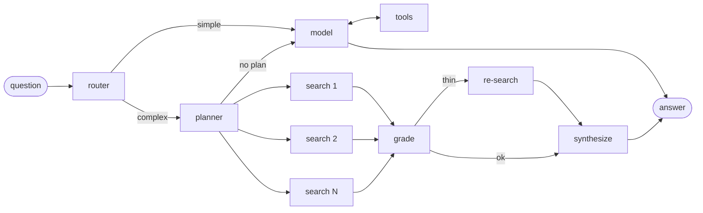

# CorpBrain: Multimodal RAG Document Assistant

CorpBrain is a **production-grade Multimodal Retrieval-Augmented Generation (RAG)** system built for dense technical documents. It combines vision-based page summarization, contextual chunking, hybrid search, cross-encoder reranking, and a full RAGAS evaluation pipeline, all wrapped in an interactive Streamlit UI.


>Main conversation page to ask questions about knowledge base


>Explore vectors, query, retrieval and ranking in latent space


>RAGAS Evaluation pipeline and insights analysis

[](https://www.youtube.com/watch?v=R_5rqiOa0P4)

>Watch the Demo
---

## Key Features

### Ingestion
- **Multimodal Vision Summarization** — Rasterizes PDF pages with embedded images (charts, diagrams, schematics) and sends them to **Claude Haiku** for rich, verbatim-aware text summaries; pure text pages skip vision for efficiency.
- **Contextual Chunking** — Implements Anthropic's contextual retrieval technique: calls Claude Haiku to prepend a 1-sentence situating context to every chunk before embedding, boosting retrieval precision and recall.
- **Deduplication** — MD5 file hashing prevents re-ingesting the same document, chunk-level context caching avoids redundant LLM calls on re-ingestion.

### Retrieval
- **Hybrid Search** — `EnsembleRetriever` fuses ChromaDB vector search (semantic) with BM25 (keyword) to capture both conceptual intent and exact technical terminology.
- **Cross-Encoder Reranking** — `ms-marco-MiniLM-L-6-v2` jointly scores every (query, candidate) pair and keeps the top 5, filtering noise from initial retrieval.
- **Multimodal Context Injection** — Retrieved image-summary chunks trigger automatic base64 encoding of the original PNG diagram, injecting it directly into **Claude Sonnet**'s context window alongside the text.
- **Streaming Responses** — Answers stream token-by-token via LangChain's streaming interface.

### Agent Mode
- **RAG / Agent toggle** in Chat. Agent mode runs a LangGraph agent on **Gemini 2.5 Flash** that decides which tools to call, and how often, before answering.
- **Router and planner** — a router call classifies each question. Simple ones go straight to the tool-calling loop. Complex ones (comparisons, multi-part, cross-document) get a structured plan of up to 4 sub-questions, whose searches run in parallel. A grader then marks any thin results, those sub-questions are searched once more with a rewritten query, and a synthesizer writes one cited answer. The plan appears in Chat before the answer streams.



- **Tools over MCP** — the agent reaches retrieval only through `mcp_server.py` over stdio MCP, the same server any MCP client can use.
- **Live tool calls** — each call and its result appear as they happen; the answer streams with inline `[source p.N]` citations, a list of the cited pages, and token usage and cost.
- **Hard caps** — at most 6 tool-enabled model calls in the loop and 8 tool calls overall. When the loop hits a cap it makes one final call without tools so it still answers, and planned searches beyond the budget are skipped. Tool errors go back to the model instead of crashing the run.

### Explore (3D Vector Space Visualizer)
- UMAP reduces all chunk embeddings to 3D; Plotly renders an interactive scatter plot colored by source document.
- Submit any query to see the full retrieval pipeline animate in real time: retrieved candidates (orange), reranked top-5 (red diamonds), and the query point (purple) plotted in the same latent space.
- Keyword-based chunk browser for manual inspection of any document chunk.

### Eval (RAGAS Evaluation Pipeline)
- Generates a synthetic Q&A test set from your own documents using Claude Haiku.
- Benchmarks up to **12 configurations** (3 retrieval strategies × 2 reranking options × 2 chunking schemes) via RAGAS metrics: Faithfulness, Answer Relevancy, Context Precision, Context Recall, and Answer Correctness.
- Surfaces actionable **Key Findings** with comparative bar charts:
  - Contextual chunking consistently improves Context Precision & Recall across all strategies.
  - MS MARCO cross-encoder reranking degrades Faithfulness on formal documents (domain mismatch).
  - Hybrid search leads all strategies on Answer Relevancy.

---

## Architecture

```
PDF(s)
  │
  ▼
[ ingest.py ]
  ├─ Phase 1: PyMuPDF text extraction + page rasterization (150 dpi)
  │           Claude Haiku vision → image_summary chunks (skips text-only pages)
  ├─ Phase 2: RecursiveCharacterTextSplitter (1000 / 200 overlap) on text docs
  ├─ Phase 3: Claude Haiku contextual chunking → prepend context sentence per chunk
  └─ Phase 4: Batch embed (Gemini embedding-001) → ChromaDB

Query
  │
  ▼
[ rag.py — MultimodalRAGChain ]
  ├─ Hybrid retrieval: ChromaDB (k=10) + BM25 (k=10) → 20 candidates
  ├─ Cross-encoder reranking → top 5
  ├─ Build multimodal payload: text context + base64 PNGs for image chunks
  └─ Claude Sonnet stream → streamed answer + source attribution

[ app.py — Streamlit ]
  ├─ Chat:    Q&A with streaming, source list, diagram display
  ├─ Explore: UMAP 3D + retrieval pipeline overlay + chunk browser
  └─ Eval:    Test set generation, baseline DB creation, RAGAS benchmark
```

---

## Tech Stack

| Layer | Tool |
|---|---|
| Embeddings | Google Gemini `embedding-001` |
| Vision / Contextual Chunking | Claude Haiku (`claude-haiku-4-5`) |
| Answer Generation | Claude Sonnet (`claude-sonnet-4-6`) |
| Eval LLM | Gemini 2.5 Flash |
| Orchestrastion Glue | LangChain |
| Vector Store | ChromaDB |
| Keyword Search | BM25 (rank-bm25) |
| Reranker | `cross-encoder/ms-marco-MiniLM-L-6-v2` |
| PDF Processing | PyMuPDF (fitz) |
| Evaluation | RAGAS |
| Dimensionality Reduction | UMAP |
| Visualization | Plotly |
| UI | Streamlit |
| Tracing | Langfuse v4 (self-hosted, Docker Compose) |

---

## Installation & Setup

### Prerequisites
- Python 3.9+
- A Google Gemini API Key
- An Anthropic API Key

### 1. Clone the Repository
```bash
git clone https://github.com/qusydani/CorpBrain
cd CorpBrain
```

### 2. Install Dependencies
```bash
pip install -r requirements.txt
```

### 3. Configure API Keys (`.env`)
```
GOOGLE_API_KEY=your_gemini_api_key_here
ANTHROPIC_API_KEY=your_anthropic_api_key_here
```

### 4. Run the App
```bash
streamlit run app.py
```

Upload PDFs via the sidebar, click **Ingest Documents**, then ask questions in the **Chat** tab. Use **Explore** to visualize your knowledge base in 3D, and **Eval** to benchmark retrieval configurations.

### 5. MCP Server (optional)

`mcp_server.py` exposes the knowledge base to any MCP client over stdio:

| Tool | What it returns |
|---|---|
| `search_documents(query, strategy, rerank, k, sources)` | Top `k` chunks (best first) with `source`, `page`, `type` (`text` / `image_summary`) and `content`. `sources` restricts the search to specific files. |
| `list_documents()` | Every ingested file with its page count. |

Try it with the MCP Inspector:
```bash
npx @modelcontextprotocol/inspector .venv/Scripts/python mcp_server.py
```

**Claude Desktop:** add this to `claude_desktop_config.json` (Settings → Developer → Edit Config), using absolute paths, then restart Claude Desktop:
```json
{
  "mcpServers": {
    "corpbrain": {
      "command": "C:\path\to\CorpBrain\.venv\Scripts\python.exe",
      "args": ["C:\path\to\CorpBrain\mcp_server.py"]
    }
  }
}
```
On macOS/Linux use `.venv/bin/python`. The server reads `GOOGLE_API_KEY` from the repo's `.env`, so nothing else needs configuring.

### 6. Agent from the CLI (optional)

```bash
python agent.py "Compare Enterprise Singapore's internationalisation support with the FY2026 budget's measures"
```

Tool calls and stats go to stderr; the streamed answer and its sources go to stdout.

### 7. Tracing with Langfuse (optional)

Self-hosted [Langfuse](https://langfuse.com) v4 records every agent question as one trace: each Gemini call is a generation with its tokens, $ cost and latency, and each MCP tool call (`search_documents`, `get_page`, `get_page_image`, `list_documents`) is a tool span with its arguments, result and latency. Requires Docker and Python 3.11+ (for the `langfuse` SDK).

1. Add the project keys to `.env`. On first boot the server creates a `corpbrain` project with exactly these keys:
   ```
   LANGFUSE_PUBLIC_KEY=pk-lf-corpbrain-local
   LANGFUSE_SECRET_KEY=sk-lf-corpbrain-local
   LANGFUSE_BASE_URL=http://localhost:3000
   ```
2. Start the stack (web, worker, Postgres, ClickHouse, Redis, MinIO):
   ```bash
   docker compose --profile observability up -d
   ```
3. Open http://localhost:3000 and sign in as `admin@corpbrain.local` / `corpbrain-admin`.
4. Start the app or run `python agent.py "..."`. Traces appear under **Tracing**; chats from one browser session share a session id.

Tracing turns on only when the keys are set and the server answers its health check when the app starts. Otherwise the app runs as usual with tracing silently off, so start Langfuse before the app, or restart the app after starting Langfuse. The first time tracing turns on, the app registers the Gemini 2.5 Flash price from `pricing.py` in the project (**Settings → Models**), so Langfuse's costs match the eval's. The admin password, keys and every database secret have local-only defaults. Override the `LANGFUSE_*` variables listed in `docker-compose.yml` before exposing the stack beyond your machine. To stop it: `docker compose --profile observability down` (add `-v` to delete trace data).
